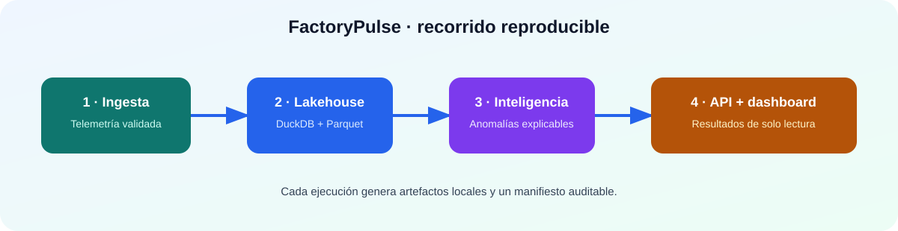

# FactoryPulse Orchestrator

> Ejecución reproducible, de extremo a extremo, de la plataforma de referencia FactoryPulse.

[](https://github.com/david2526IA/factorypulse-orchestrator/actions/workflows/ci.yml)
[](https://github.com/david2526IA/factorypulse-contracts)

<p align="center"></p>

Este repositorio demuestra una plataforma conectada, no una colección de ejemplos aislados. Instala versiones fijadas de cada componente y ejecuta el recorrido completo desde telemetría simulada hasta artefactos preparados para una API de solo lectura.

## Qué resuelve

| Necesidad | Respuesta del proyecto |
| --- | --- |
| Reproducibilidad | Las dependencias internas están fijadas a commits concretos. |
| Trazabilidad | Cada ejecución crea un manifiesto con parámetros y artefactos. |
| Calidad de datos | La telemetría se valida antes de alimentar el lakehouse. |
| Operación explicable | Las anomalías incluyen motivos; la API solo expone resultados. |

## Ejecución rápida

```bash
git clone https://github.com/david2526IA/factorypulse-orchestrator.git
cd factorypulse-orchestrator
python -m venv .venv
# Activa el entorno virtual según tu sistema operativo
pip install -e ".[dev]"

factorypulse-run run --workspace artifacts/demo --count 120 --fault-after 85
factorypulse-run serve --workspace artifacts/demo
pytest -q
```

Después, abre `http://127.0.0.1:8000/docs` para consultar la API. El [dashboard de FactoryPulse](https://github.com/david2526IA/factorypulse-dashboard) puede consumir una URL compatible con el parámetro `?api=`.

## Artefactos generados

```text
artifacts/demo/
├── telemetry.jsonl                 # telemetría simulada validada
├── anomalies.jsonl                 # señales explicables detectadas
├── warehouse/
│   ├── warehouse.duckdb
│   ├── silver_telemetry.parquet
│   └── gold_asset_health.parquet
├── api-data/                       # directorio listo para la API
│   ├── warehouse.duckdb
│   ├── anomalies.jsonl
│   └── data_quality_event.json
└── run_manifest.json               # parámetros y resultados
```

## Criterios de diseño

- Actualizar un componente es una decisión explícita y revisable; no se aceptan cambios silenciosos por versiones flotantes.
- Los resultados se conservan como ficheros locales para poder inspeccionarlos y repetir la demostración.
- El repositorio prueba el flujo completo en CI, no solo funciones aisladas.

## Límite operativo

FactoryPulse es una plataforma de referencia simulada y de solo lectura. No controla actuadores ni debe conectarse a equipos reales sin un programa independiente de ingeniería, ciberseguridad y seguridad funcional.

## English summary

This repository runs the pinned FactoryPulse components end-to-end: simulated telemetry, contract-aware lakehouse, explainable anomaly detection and read-only API-ready artifacts. Every run produces a manifest for reproducibility. It is a simulated reference platform, not an industrial control system.

## Licencia

MIT © 2026 David
